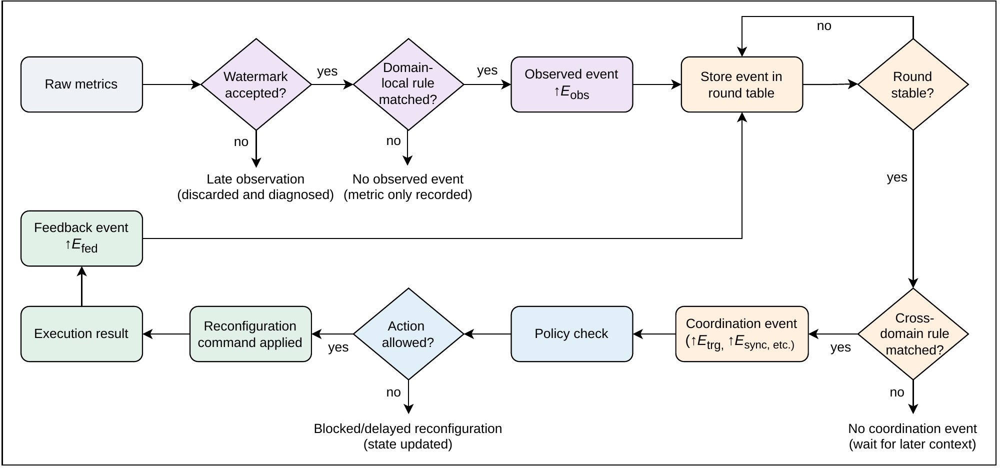

# Event and stream contracts

## End-to-end control flow

The Event Composer evaluates domain-local rules on admissible metrics and
publishes observed events (`E_obs`). The CEP uses domain watermarks to close
stable rounds in the Round Table and evaluates configured patterns, including
cross-domain rules. Matches can emit coordination events (`E_trg`, `E_sync`,
`E_block` or `E_unblock`). The Coordinator applies policy before dispatching
actions. The Executor publishes each execution outcome as `E_fed` for the CEP
to use in subsequent evaluations.

## Redis Streams

Redis Stream records carry a JSON envelope in the `data` field. Timestamps are fractional Unix seconds. The stream names below are implemented contracts, not transport-agnostic placeholders.

| Stream | Producer → consumer | Main fields |
|---|---|---|
| `metrics:<domain>` | Monitor → domain Composer | `domain`, `metric: {metric, value}`, `event_time`, `processing_time`, `sequence`, `metadata` |
| `events:obs` | Composer/Executor → CEP | Observed event or execution feedback |
| `events:late` | Composer → inspection | Rejected metric with watermark/lateness context |
| `clock:watermark` | Composer → CEP | `domain`, `watermark`, `max_event_time_seen`, delay and tolerance |
| `clock:tick` | CEP → inspection | `tick`, `tick_start`, `tick_end`, `watermark` |
| `events:coord` | CEP → Coordinator | `coord_type`, `policy`, priority, participants, round boundaries and blocking metadata |
| `executor:commands` | Coordinator → Executor | `type`, `domain`, `params`, `policy`, `action_id`, `ticket_id`, `coordination_event_id` |
| `control:clock` | Composer → external operations | Clock-resynchronization request; not proof of clock adjustment |

Observed events include `event_type`, `domain`, event/processing time, `watermark`, `watermark_before`, `accepted`, `late`, `origin_metric`, `origin_value`, and provenance metadata. Execution feedback uses `event_type: E_fed`, a `feedback_type`, and a `payload` containing action identity, domain, status and post-condition details.

`E_fed` event time is the actual completion/report time. `payload.trigger_tick_end` preserves the originating round boundary. Consumers should identify redelivered feedback by `payload.action_id`.

External producers for the isolated CEP profile must publish actual observations before watermark progress that makes their rounds stable. All domains in `cep.watermark_domains` must progress. Missing or idle domains are not removed automatically. Ordinary observations do not reopen an already-closed round; Composer lateness tolerance is not a CEP result-revision protocol. Explicit administrative force-processing patterns are a separate configured exception.

Malformed metric envelopes (including non-finite timestamps/values), malformed observation envelopes and unknown CEP domains are diagnosed and skipped without advancing the temporal frontier. Domain qualification is checked against the configured producers. Invalid source timestamps are collection failures, not local-clock fallback.

The `tick` in a coordination event names the round being evaluated, even if its supporting observation comes from retained history. Its provenance anchor is selected from matching, stable context; an event in an open future round cannot supply that anchor. For absolute Unix-time ticks, startup begins at the earliest available input frontier rather than emitting empty closures since 1970.

## CEP recovery

The CEP keeps its working Round Table in memory and saves it to `syntony:cep:round_checkpoint` after each nonempty input batch. The Redis transaction writes the retained observations, per-domain watermarks, round origin, last closed round and input stream cursors together with the batch's `clock:tick` and `events:coord` entries. On restart it restores this checkpoint and reads only after the saved cursors. Redis persistence and retention determine which committed state survives a Redis restart.

Use one CEP per Redis instance. The checkpoint records a digest of the CEP configuration. For changes to that configuration, start with a fresh Redis instance or explicitly manage migration of the checkpoint and streams together. An existing deployment upgraded from a version without a checkpoint starts by reading the retained input streams and can republish historical rounds during this initial replay.

The Round Table and its checkpoint use round terminology. The `clock:tick` stream name, `tick*` envelope fields and existing JSON timing keys remain wire and configuration identifiers for compatibility.

For versioned policy activation and its feedback contract, see [meta-reconfiguration](meta-reconfiguration.md).

## Event taxonomy

| Thesis family | Runtime representation | Purpose |
|---|---|---|
| `E_obs` | Domain-local `event_type` named by a Composer rule | Report a recognized local condition |
| `E_trg` | Coordination `coord_type` | Submit an adaptation candidate |
| `E_sync` | Coordination `coord_type` | Submit a joint plan for participating domains |
| `E_block` | Coordination `coord_type` with `block_id`, `block_domain` and action types | Activate a named action guard |
| `E_unblock` | Coordination `coord_type` with the same guard identity | Release that guard |
| `E_fed` | Observation `event_type` with a feedback subtype | Report an execution outcome |

These identifiers follow the thesis's proposal and instantiation chapters. An observed event keeps its domain-specific name, such as `host_load_high`, so patterns can identify the recognized condition.

## Blocking and release

`E_block` carries `blocked_action_types`, `block_scope` and `block_ttl_seconds`. Its guard identity is `(block_id, block_domain)`. `block_id` defaults to the blocking pattern's name; `block_domain` defaults to the pattern's domain. Declare both explicitly when a cross-domain pattern manages a guard owned by another domain.

`E_unblock` names an existing guard through `block_id` and `block_domain`; it has its own pattern/policy name and needs no executor mapping. The Coordinator removes the matching lease and records the release identity in one Redis transaction. Replaying that release leaves a subsequently renewed guard intact. A release timestamp older than the current guard leaves the newer guard active; a delayed block older than the latest release is ignored.

The host-pressure example emits release only when the stable round contains a normal-load observation and no high-load observation.

Guard leases also expire at their configured TTL. Explicit release handles a recognized clearing condition before expiry. Other guard identities remain active, and releasing a blocking lease leaves action-plan exclusivity and uncertainty flags under their execution/recovery policies.
